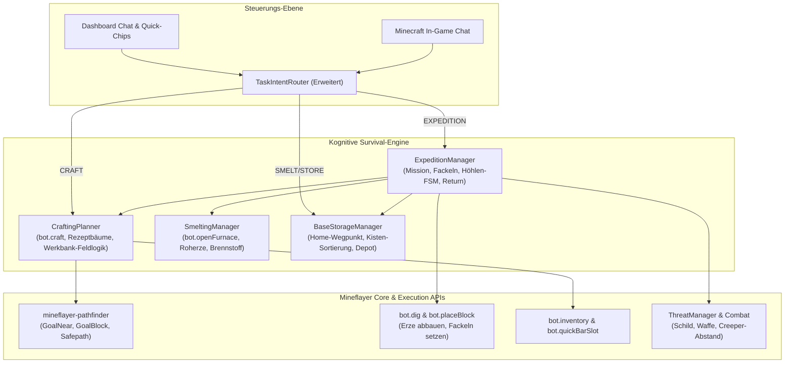

# Spezifikation: Vollwertiges Survival- & Höhlen-Expeditions-System (Voyager & Mineflayer SOTA)

> **Dokument:** SURVIVAL_EXPEDITION_SPEC.md  
> **Status:** Genehmigt und bereit zur Umsetzung  
> **Zielversion:** Minecraft Java Edition 1.20.4 bis 26.3 (Protokoll 777)  
> **Vorbild-Projekte:** Voyager (Nvidia/Wang et al.), Mindcraft, Mineflayer Core SOTA  

---

## 1. Vision & Zusammenfassung der Systementscheidungen

Der Bot wird von einem reinen Bau- und einfachen Abbau-Agenten zu einem **vollwertigen, eigenständigen Minecraft-Survival-Spieler** ausgebaut, der moderne Java-Versionen (1.20.4 bis 26.3 / Protokoll 777) meistert und `mineflayer` voll ausschöpft.

### Entschiedene Kernsäulen:
1. **Hybrides modulares System:**
   * Umschaltbar zwischen **Baumeister** (Architektur), **Autonomer Minenarbeiter / Höhlenforscher** (Expeditionen) und **Gebietsverteidiger** (Wachdienst).
2. **Rekursiver Auto-Crafting & Smelting Planner (Voyager-Stil):**
   * Löst Rezeptbäume rekursiv auf: Holz $\rightarrow$ Werkbank $\rightarrow$ Stöcke $\rightarrow$ Spitzhacken aller Tiers.
   * Verhüttung: Roherz + Brennstoff $\rightarrow$ Ofen $\rightarrow$ Barren.
   * Mobiles Aufstellen und Wieder-Abbauen von Werkbank und Ofen bei Bedarf im Feld.
3. **Autonomer Solo-Höhlengänger & Minen-Expeditionen:**
   * Geht selbstständig in Höhlensysteme und Schächte.
   * **Fackel-Automatik:** Platziert Fackeln an Boden/Wand, sobald das Block-Lichtlevel 0 erreicht (Spawn-Schutz).
   * Schürft alle Erze (Eisen, Kohle, Kupfer, Gold, Redstone, Lapis, Diamant) mit Fallschutz und Lavaschutz.
4. **Heimatbasis, Depot & Schmelz-Zentrum:**
   * Wegpunkt-Gedächtnis (`!sethome` oder Chatbefehl *"Das ist unsere Basis"* in `data/waypoints.json`).
   * **Smart Return:** Kehrt selbstständig zur Basis zurück, wenn:
     * Inventar voll ($\ge 30$ Slots belegt),
     * Erzziel erreicht,
     * Werkzeuge aufgebraucht,
     * Nahrung zur Neige geht.
   * **Lager-Logistik:** Sortiert Erze und Beute in Kisten ein und bestückt Basis-Öfen mit Roherzen und Brennstoff.
5. **Nahrungs-Modell:**
   * Entnahme aus Kistenvorräten; kein Ackerbau durch den Bot erforderlich.
6. **Mineflayer-Nutzung & Protokollsicherheit:**
   * Hybride Architektur: Maximale Ausschöpfung der nativen Mineflayer Core-APIs (`bot.craft`, `bot.openFurnace`, `bot.recipesAll`, `bot.pathfinder`) kombiniert mit resilienten Modulen für moderne Server (1.20.4 bis 26.3 / Protokoll 777), vollständig offline testbar.

---

## 2. Gesamtarchitektur & Datenfluss

---

## 3. Die neuen Komponenten im Detail

### 3.1 `CraftingPlanner` (`src/survival/craftingPlanner.js`)
* **Aufgabe:** Selbstständige Werkzeug-, Fackel- und Ofenherstellung.
* **Funktionen:**
  - `craftItem(bot, itemName, count = 1)`
  - `resolveRecipeTree(bot, itemName, count)`: Berechnet fehlende Zwischenstufen (z. B. für `iron_pickaxe`: benötigt 3 `iron_ingot`, 2 `stick`. Für `stick`: benötigt 2 `planks`. Für `planks`: benötigt 1 `log`).
  - **Mobiles Werkbank-Management:**
    1. Sucht eine Werkbank im 4m-Radius.
    2. Falls keine vorhanden: Prüft Inventar auf `crafting_table` (oder craftet eine aus 4 Planken).
    3. Platziert die Werkbank auf einem freien soliden Nachbarblock.
    4. Führt `bot.craft(recipe, count, tableBlock)` aus.
    5. Baut die Werkbank per `bot.dig(tableBlock)` wieder ab und nimmt sie wieder ins Inventar.

### 3.2 `SmeltingManager` (`src/survival/smeltingManager.js`)
* **Aufgabe:** Verhüttung von Roherzen (`raw_iron`, `raw_copper`, `raw_gold`, `sand`, `cobblestone`).
* **Funktionen:**
  - `smeltMaterials(bot, options)`
  - Erkennt Öfen im 8m-Radius (oder platziert temporär einen Ofen).
  - Öffnet den Ofen via `bot.openFurnace(furnaceBlock)`.
  - Wählt geeigneten Brennstoff (Kohle, Holzkohle, Planken, Stöcke).
  - Wartet auf Schmelzvorgang und entnimmt die fertigen Barren (`iron_ingot`, `gold_ingot`, etc.).

### 3.3 `ExpeditionManager` (`src/survival/expeditionManager.js`)
* **Aufgabe:** Autonome Solo-Höhlen-Expeditionen mit Fackel-Sicherheit und Smart-Return.
* **FSM-Zustände:**
  - `PREPARING`: Prüft Spitzhacken (mindestens Stein/Eisen), Nahrung und Fackeln. Craftet vor Start bei Bedarf Fackeln und Werkzeuge.
  - `EXPLORING_CAVE`: Sucht nach unbeleuchteten Höhlensegmenten oder Erzen im Umkreis.
  - `LIGHTING`: Prüft bei jedem Schritt das Block-Lichtlevel (`block.light`). Wenn `light === 0`, platziert der Bot eine Fackel an Wand oder Boden.
  - `MINING_VEIN`: Baut alle zusammenhängenden Blöcke einer Ader ab und sammelt die Drops auf.
  - `DEFENDING`: Wenn Monster auftauchen, zückt er Schild und Schwert (integriert in `threatManager`).
  - `RETURNING_HOME`: Aktiviert bei vollem Inventar ($\ge 30$ Slots) oder Erreichen des Ziels die Navigation zurück zur Heimatbasis.
  - `UNLOADING_AT_BASE`: Sortiert die Schätze in Basiskisten ein und füttert die Öfen.

### 3.4 `BaseStorageManager` (`src/survival/baseStorageManager.js`)
* **Aufgabe:** Wegpunkt-Speicher (`data/waypoints.json`) und automatisches Kistendepot.
* **Funktionen:**
  - `setHome(position)`: Speichert Koordinaten der Basis.
  - `getHome()`: Liest Heimatposition aus.
  - `depositLoot(bot)`: Durchsucht Behälter der Basis:
    - Erze/Barren in Kiste mit Erzen oder freie Fächer.
    - Monster-Drops (Pfeile, Knochen, Schießpulver) in Beutekiste.
    - Baumaterialien (Cobblestone, Deepslate) in Steinekiste.

---

## 4. Chat- und Dashboard-Integration

### Neue Chat-Befehle (In-Game & Dashboard):
* `!sethome` / *"Merke dir diesen Ort als Basis"* $\rightarrow$ Setzt Home-Wegpunkt.
* `!home` / *"Komm nach Hause"* $\rightarrow$ Bot kehrt sofort zur Basis zurück.
* `!expedition [erz] [menge]` / *"Gehe auf Minen-Expedition nach Eisen und Diamanten"* $\rightarrow$ Startet Solo-Höhlen-Tour.
* `!craft <item> [menge]` / *"Crafte 16 Fackeln"* $\rightarrow$ Startet den Crafting-Planner.
* `!smelt` / *"Schmilz alle Roherze im Ofen"* $\rightarrow$ Startet SmeltingManager.
* `!deposit` / *"Räume dein Inventar in die Kisten"* $\rightarrow$ Entlädt Beute in die Basislager.

---

## 5. Implementierungs- und Test-Fahrplan

1. **Phase 1: `CraftingPlanner` & `SmeltingManager`**
   - Native Mineflayer-Rezepte (`bot.craft`, `bot.recipesAll`) & mobile Werkbank-Setz-/Abbaulogik.
   - Unit-Tests mit Mock-Bot für Rezeptbäume (z.B. Eisen-Spitzhacke, Fackeln).
2. **Phase 2: `BaseStorageManager` & Wegpunkt-Persistenz**
   - JSON-Speicher für Home und Minen-Eingänge (`data/waypoints.json`).
   - Kisten-Entlade- und Sortierlogik.
3. **Phase 3: `ExpeditionManager` (Fackeln, Höhlen-FSM, Smart-Return)**
   - Lichtlevel-Erkennung, automatisches Fackel-Setzen bei Dunkelheit.
   - Smart-Return bei vollem Inventar oder Zielerreichung.
4. **Phase 4: Router- & Chat-Integration**
   - Erweiterung von `src/ai/router/taskIntentRouter.js`, `src/web/ws/handlers/architectWsHandler.js` und `src/bot/chatController.js`.
   - Neue Quick-Chips im Web-Dashboard (`src/web/public/index.html`).
5. **Phase 5: Umfassende Offline-Testsuite**
   - `test/fullSurvivalExpeditionTest.js` zur Verifikation aller Phasen mit 100% Exit Code 0.
